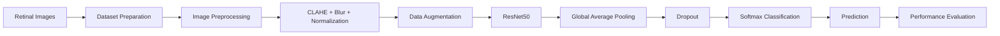

<div align="center">

# 👁️ Diabetic Retinopathy Detection

### Deep learning-based retinal image classification

An image analysis and deep learning project for detecting **Diabetic Retinopathy (DR)** from retinal fundus images using a fine-tuned **ResNet50** model.


[Overview](#-overview) · [Features](#-features) · [Pipeline](#-pipeline) · [Model](#-model) · [Quick start](#-quick-start) · [Results](#-results) · [Roadmap](#-roadmap)

</div>

---

## 🌿 Overview

**Diabetic Retinopathy Detection** is a deep learning project focused on identifying diabetic retinopathy from retinal images.

The project uses image preprocessing, data augmentation, transfer learning, and fine-tuning to train a **ResNet50** model for retinal image classification.

The notebook includes dataset preparation, image analysis, CLAHE-based enhancement, model training, fine-tuning, and performance visualization.

> **Reported final model accuracy: 94.2%**

## 🎯 Features

| | Feature | What it does |
|---|---|---|
| 🖼️ | **Retinal image analysis** | Loads and analyzes retinal fundus images from the dataset. |
| 🔧 | **Image preprocessing** | Resizes images, applies CLAHE enhancement, Gaussian blur and normalization. |
| 🔄 | **Data augmentation** | Uses flipping, rotation, zoom and contrast augmentation during training. |
| 🧠 | **Transfer learning** | Uses ImageNet-pretrained ResNet50 as the feature extraction backbone. |
| 🎯 | **Fine-tuning** | Unfreezes later ResNet50 layers for additional training. |
| ⚖️ | **Class weighting** | Calculates class weights to help address class imbalance. |
| 📊 | **Performance analysis** | Includes accuracy/loss plots, confusion matrix, ROC curves and class-level metrics. |
| 💾 | **Model checkpointing** | Saves the best-performing model based on validation accuracy. |

## 🧩 Pipeline



## 🖼️ Image preprocessing

The preprocessing pipeline includes:

```text
Retinal Image
     ↓
Resize to 512 × 512
     ↓
RGB Conversion
     ↓
LAB Color Space
     ↓
CLAHE Enhancement
     ↓
Gaussian Blur
     ↓
Normalization
     ↓
Model Input
```

CLAHE is used to improve local contrast in retinal images before model training.

## 🧠 Model Architecture

The project uses **ResNet50 pretrained on ImageNet** as the base model.

The classification architecture is:

```text
Input: 512 × 512 × 3
        ↓
ResNet50 Backbone
        ↓
Global Average Pooling
        ↓
Dropout (0.4)
        ↓
Dense Softmax Layer
        ↓
Class Prediction
```

Initially, the ResNet50 base is frozen while the custom classification head is trained. The later layers are then unfrozen for fine-tuning with a lower learning rate.

### Training configuration

| Parameter | Value |
|---|---:|
| Image size | `512 × 512` |
| Batch size | `32` |
| Initial learning rate | `1e-4` |
| Fine-tuning learning rate | `1e-5` |
| Optimizer | Adam |
| Loss | Categorical Crossentropy |
| Dropout | `0.4` |
| Base model | ResNet50 |
| Pretrained weights | ImageNet |

## 📂 Dataset Preparation

The notebook supports extracting a ZIP dataset and automatically locating the dataset structure.

The processed dataset is organized using class folders, allowing TensorFlow's `image_dataset_from_directory` to infer labels.

The notebook also creates a dataset manifest containing:

- File path
- Class label
- Image size in bytes

```text
dataset_manifest.csv
```

## 🚀 Quick start

**Recommended environment:** Google Colab or a Python environment with TensorFlow and the required libraries.

### 1. Clone the repository

```bash
git clone https://github.com/<your-username>/diabetic-retinopathy-detection.git
cd diabetic-retinopathy-detection
```

### 2. Install dependencies

```bash
pip install -r requirements.txt
```

### 3. Prepare the dataset

Upload your retinal image dataset as a ZIP file and update the dataset path if required.

The notebook extracts the dataset and automatically searches for the expected class-folder structure.

### 4. Run the notebook

Open:

```text
Diabetic retinopathy detection.ipynb
```

Run the cells sequentially to:

1. Prepare the dataset
2. Generate the dataset manifest
3. Inspect retinal images
4. Preprocess images
5. Build the ResNet50 model
6. Train and fine-tune the model
7. Evaluate performance
8. Generate visualizations

## 📊 Results

The project reports a final model accuracy of:

# **94.2%**

The notebook includes several evaluation visualizations:

- 📈 Training vs. validation accuracy
- 📉 Training vs. validation loss
- 🔲 Confusion matrix
- 📊 ROC curves
- 🎯 Accuracy, precision, recall and F1-score comparisons
- 🧪 Ablation study visualization

## 📈 Evaluation

The notebook evaluates the model using class-level performance metrics and visual analysis.

The reported class labels used in the evaluation include:

```text
No DR
Mild
Moderate
Severe
Proliferative
```

These correspond to different stages/categories represented in the notebook's evaluation visualizations.

## 🛠️ Tech Stack

- **Python** — Core programming language
- **TensorFlow / Keras** — Deep learning and model training
- **ResNet50** — Transfer learning backbone
- **OpenCV** — Image processing and preprocessing
- **NumPy** — Numerical computation
- **Pandas** — Dataset manifest and data handling
- **Matplotlib** — Visualization
- **Seaborn** — Confusion matrix visualization
- **Google Colab** — Notebook-based training environment

## 📁 Project structure

```text
diabetic-retinopathy-detection/
├── Diabetic retinopathy detection.ipynb
├── README.md
├── requirements.txt
├── dataset_manifest.csv       # Generated during preprocessing
├── best_model.h5              # Generated model checkpoint
└── dataset/                   # Retinal image dataset
```

## ⚠️ Limitations

- The project is intended as a **deep learning/research prototype**, not a clinical diagnostic system.
- Model performance depends on dataset quality and distribution.
- Retinal image quality, lighting and acquisition conditions can affect predictions.
- The notebook is designed around the dataset structure used during development.
- A high classification accuracy does not replace evaluation and validation by qualified medical professionals.

## 🗺 Roadmap

- [x] Retinal image preprocessing
- [x] CLAHE enhancement
- [x] Data augmentation
- [x] ResNet50 transfer learning
- [x] Fine-tuning
- [x] Class weighting
- [x] Model checkpointing
- [x] Performance visualization
- [ ] External dataset validation
- [ ] Model explainability with Grad-CAM
- [ ] Web-based prediction interface
- [ ] Model deployment API
- [ ] Clinical validation

## 🤝 Contributing

Ideas and pull requests are welcome.

1. Fork the repository
2. Create a branch:

```bash
git checkout -b feature/my-feature
```

3. Commit your changes:

```bash
git commit -m "Add my feature"
```

4. Push the branch and open a pull request.

## 📄 License

Add your preferred license here, for example:

```text
MIT License
```

---

<div align="center">

Built with Python, TensorFlow, ResNet50 and OpenCV 🧠

**Early detection can help support better diabetic eye-care outcomes. 👁️**

If you find this project useful, consider giving it a ⭐

</div>
